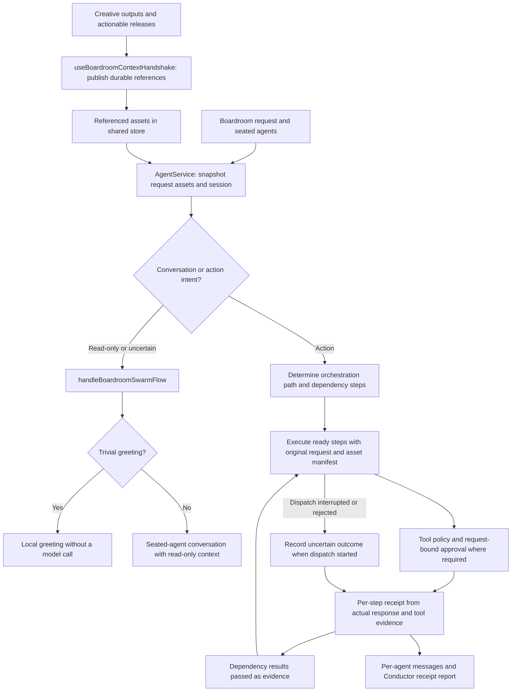

# Boardroom Context and Execution

Reviewed 2026-11-05. This chart describes the implementation; the [model migration chart](chat-model-routing-and-approval.md) separates current routing from the intended Argon architecture.

## Transition Breakdown

1. `useBoardroomContextHandshake.ts` publishes up to three recent supported creative outputs with durable references and up to two actionable releases. References supply context; they do not establish that an agent executed work.
2. `AgentService.handleBoardroomRequestFlow` snapshots uploads, references, gallery assets, and the active session. Image attachments retain their original pixels; the textual manifest uses aliases and elides base64 payloads.
3. Conversation and uncertain intent use a read-only dispatch. Trivial greetings can return a local template. A successful greeting therefore does not verify provider connectivity or tool execution.
4. Action routing builds single, parallel, or graph-derived steps. Each dispatched step receives the original request, source references, assigned owner, and dependency evidence. Tool approval remains a separate gate.
5. Each step produces a receipt; remaining steps can be skipped. The final Conductor response aggregates those receipts. An interrupted response after dispatch can leave an uncertain outcome requiring reconciliation.

## Diagnosis boundaries

The reported specialist-unavailable errors and repeated `report_bug` approval pauses affect the investigation of both direct chat and Boardroom. The reviewed code does not establish a general “summary protocol overwrites drafts” cause. Do not present that explanation or Department mode as a verified remedy. Asset retrieval, provider connectivity, approval continuation, and delivery rendering require separate checks.

Sources: `packages/renderer/src/hooks/useBoardroomContextHandshake.ts`, `packages/renderer/src/services/agent/AgentService.ts`, and its imported Boardroom receipt helpers. See [bug reporting and approval](08-bug-reporter-pipeline.md).
