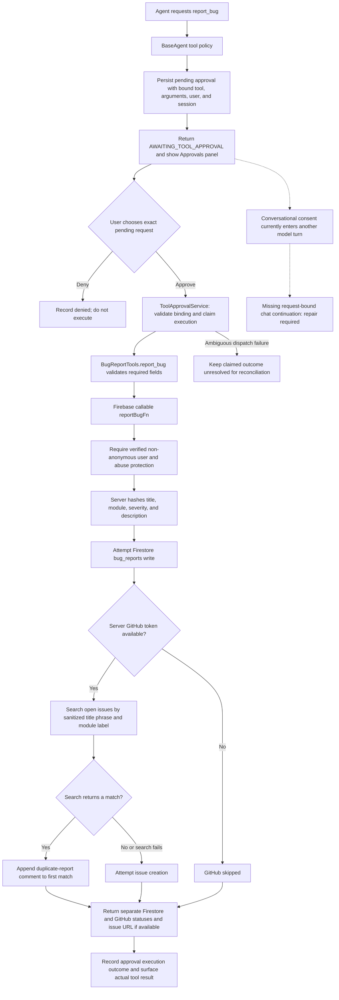
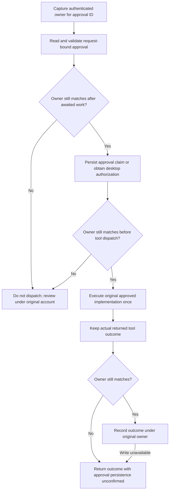

# Bug Reporting and Approval

Reviewed 2026-11-05. Agent-requested reporting has an approval gate before the reporting tool runs. A chat reply expressing consent currently does not establish that the pending approval was executed.

## Transition Breakdown

1. `BaseAgent.ts` binds the implementation, original arguments, schema, and execution context to a persisted approval request. It pauses without executing the tool.
2. `governance/ToolApprovalService.ts` approves a specific ID, validates the binding, and records a durable claim before dispatch. Denial does not execute the call. Ambiguous dispatch failures must not invite an automatic duplicate execution.
3. The current chat path lacks a request-bound natural-language approval continuation. Repeated “I approve” messages can produce another tool proposal and pause. A repair must identify the exact request and preserve its arguments and identity checks.
4. `BugReportTools.ts` calls **reportBugFn**, not a callable named reportBug. The server computes a truncated SHA256 key from title, module, severity, and description; the earlier chart incorrectly placed hashing in the client.
5. `reportBugFn.ts` attempts Firestore persistence before GitHub synchronization and reports channel statuses separately. GitHub credentials remain server-side. Authentication or abuse-protection rejection stops the callable before these writes.
6. GitHub deduplication is best effort: phrase search plus a module label, followed by the first match. Search errors fall back to creation. This is not an exact-title check, author restriction, or atomic guarantee against duplicate issues.

## Acceptance evidence still required

Verify approving and denying the same pending request in the real UI; ensure consent cannot authorize a different request; test interruption and duplicate clicks; confirm the original result returns to the conversation. Confirm a returned issue URL and persistence status before claiming a report was filed. An existing issue proves one report reached GitHub, not that every approval path works.

## Approval owner boundaries

Owner checks also fence denial reads and transactions. Desktop denial and
completion payloads carry `expectedOwnerId`; the callable compares it with the
authenticated UID before reading the approval. Authentication remains the source
of authority. The expected owner field is optional for existing clients.
Completion requires a boolean success value, so a string such as `"false"` cannot
be recorded as success through coercion.

An owner change before dispatch leaves the tool unexecuted; any persisted claim
may still need review under the original account. A change after dispatch does
not erase the actual outcome or authorize a retry. Effects already started are
not cancelled by these checks. Structural account-switch tests cover these
boundaries; genuine multi-account UI acceptance remains unverified.
