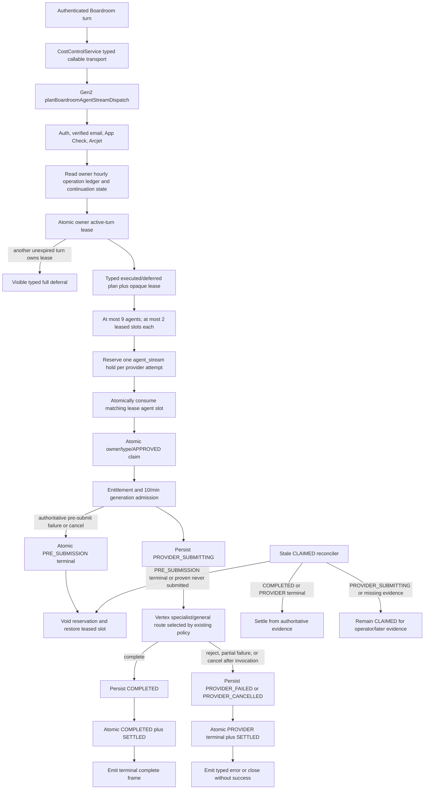

# Agent-stream reservation and Boardroom budget lifecycle

The billing ledger is the authority. Claims and lifecycle transitions validate
the authenticated owner, `agent_stream` type, server claim ID, and current
status transactionally. Terminal lifecycle and financial status are written by
one atomic helper: only authoritative pre-submission abandonment maps to
`VOIDED`; once the conservative provider invocation boundary is crossed,
rejection, partial output, cancellation, and completion map to `SETTLED`.
Lifecycle transitions are monotonic and finalization is single-flight, so a
late disconnect cannot downgrade submitted work into a refund or race a
completion write. Reconciliation uses the existing 15-minute stale query only
to find candidates; age never chooses the financial outcome.

The Boardroom plan is also server-owned. It reads the owner-scoped hourly
operation count, which includes approved/claimed/settled reservations and is
decremented by voids. Free turns retain one continuation call; Pro turns retain
two. The same owner-scoped Firestore transaction creates one expiring active-turn
lease, so desktop, mobile, and additional tabs cannot concurrently receive the
same advertised capacity. Each executed agent receives at most two lease slots;
creating its `agent_stream` reservation consumes one matching slot atomically,
and an authoritative pre-submission void restores that slot. A completed turn
releases the lease, while a crashed turn expires and resumes from its first
unconsumed agent. The existing 10-per-minute FIFO pacing and per-call reservation
transaction remain hard boundaries. Deferred agents are rendered visibly.
`CostControlService` only transports and validates the typed server plan; it
performs no local budget arithmetic. Transport or schema failure visibly defers
every seated specialist and submits no provider request.

No tier or identity bypass is introduced. Founder/admin identities still pass
through the existing daily, monthly, runaway, authentication, App Check,
admission, routing, and capacity contracts.
