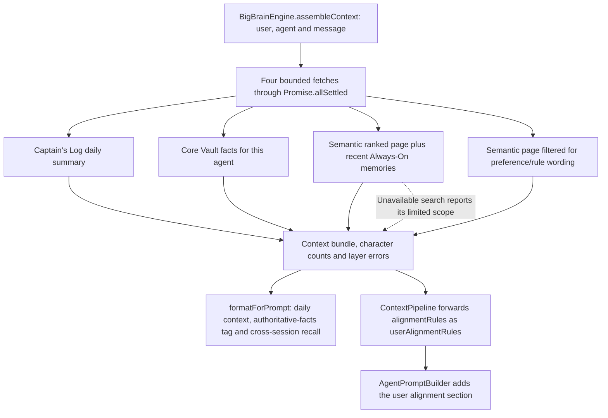
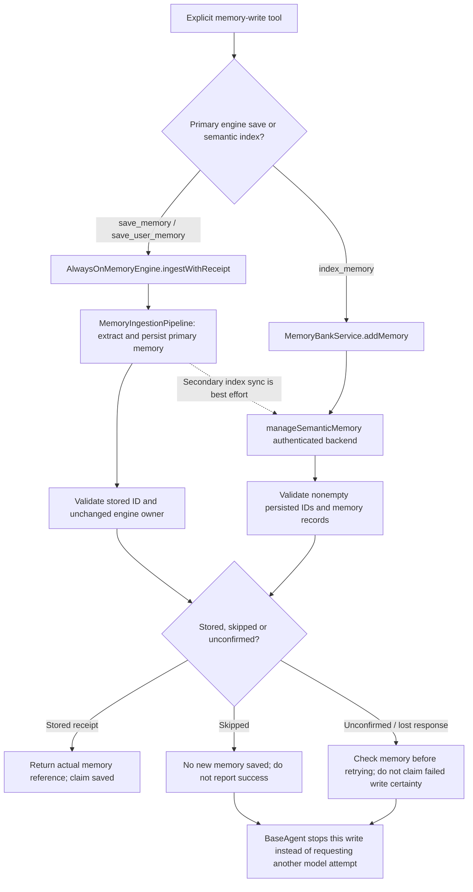

# BigBrain memory assembly and write receipts

This map describes the inspected context-assembly and explicit memory-write paths.
Stored content is not automatically verified truth. Local structural tests do not
establish deployed persistence, future recall, or full memory continuity.

## Transition Breakdown

- `BigBrainEngine.assembleContext` fetches four sources with independent character
  budgets and collects rejected layer errors. Its formatter includes three text
  sections; alignment rules remain a separate field forwarded by ContextPipeline to
  AgentPromptBuilder. This diagram does not claim that every application entry
  point consumes every field.
- Semantic recall uses one ranked page and reports its scope, then supplements it
  with recent Always-On memories. A successful empty page differs from an
  unavailable search; neither proves every historical memory was checked.
- The primary ingestion pipeline returns a stored ID, a skip, or failure data.
  Explicit save tools consume the engine's structured receipt rather than parsing
  presentation strings. A changed engine owner invalidates the active receipt.
- Semantic indexing uses the authenticated callable; client-side user IDs are
  not forwarded as backend ownership authority. Missing/malformed save receipts
  and rejected requests are not converted into successful empty writes.
- A primary save receipt does not prove secondary indexing or later retrieval.
  Unknown outcomes are not automatically repeated because a lost response may
  follow a successful write. Cross-restart reconciliation and indexing backfill
  remain open.

Sources: `packages/renderer/src/services/agent/memory/BigBrainEngine.ts`,
`AlwaysOnMemoryEngine.ts`, `MemoryIngestionPipeline.ts`, `MemoryBankService.ts`,
`packages/renderer/src/services/agent/tools/MemoryTools.ts`, and
`packages/firebase/src/functions/agent/manageSemanticMemory.ts`,
`packages/renderer/src/services/agent/components/ContextPipeline.ts`, and
`packages/renderer/src/services/agent/builders/AgentPromptBuilder.ts`.
