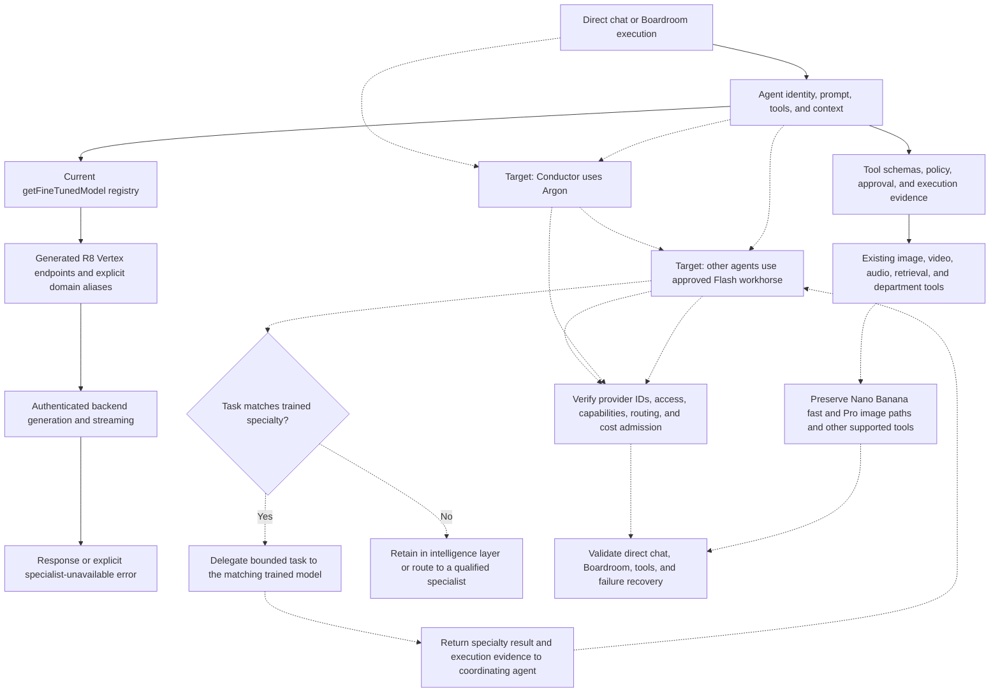

# Chat Model Routing and Migration

Reviewed 2026-11-05. The founder-approved target is a hierarchy: Argon directs the Conductor; Flash 3.8 supplies the other agents’ reasoning and coordination; trained models perform delegated work only within their specialties. Preserve the trained models. Solid edges below show inspected implementation; dashed edges show the target requiring runtime verification.
Reviewed 2026-11-05. Solid edges below show inspected implementation. Dashed edges show the intended migration and its acceptance work; they are not deployed-state claims.

## Transition Breakdown

1. `packages/renderer/src/services/agent/fine-tuned-models.ts` currently requires a tuned endpoint for each valid agent, directly or through an alias. `IndiiNucleus.ts` also selects the generalist tuned model. Updating only a central model label would not migrate these call sites.
2. The founder confirms Argon for the Conductor and Flash 3.8 for the other agents’ intelligence. Trained models remain specialty workers under that intelligence layer. Route only matching, bounded tasks to them; preserve their distinct prompts, tool permissions, and domain identity. Confirm exact provider API IDs and access before wiring the target. This chart does not assert the target is deployed.
2. The founder directs Conductor to Argon and other agents to Flash. The recalled “Flash 3.5” version needs confirmation against the approved current provider catalog before selecting an API ID. Argon is the target, not an assertion that existing tuned endpoints already serve it.
3. Model migration must cover renderer selection, backend provider routing, supported tool schemas, streaming, token and cost reservation, and error attribution. Preserve agent identities, scoped permissions, and evidence-based receipts.
4. Media tools have their own provider/model paths. Keep fast Nano Banana and Pro image generation, plus other supported agent tools, in the acceptance matrix. A text-model migration alone does not validate image generation or asset retrieval.
5. A specialist-unavailable response is a surfaced failure, not proof of its root cause. The backend classifier groups multiple provider errors; diagnose the original provider status and routing configuration before naming an outage.
6. Keep approvals deterministic and request-bound. See [approval lifecycle](08-bug-reporter-pipeline.md) and [Boardroom execution](04-boardroom-context-orchestration.md). Provider success, tool authorization, tool completion, and visible deliverable rendering are separate acceptance checks.

## Completion criteria

Confirm exact provider model IDs and account access; implement the intelligence hierarchy while retaining specialty-scoped trained routing; verify matching specialty dispatch, out-of-scope rerouting, and result handoff; verify genuine authenticated direct and Boardroom requests; exercise request-bound approve/deny and recovery; verify fast and Pro images and retained tools; inspect exact-commit CI and deployed behavior before calling the migration complete.
Confirm exact provider model IDs and account access; replace or explicitly retire old tuned routing; verify genuine authenticated direct and Boardroom requests; exercise request-bound approve/deny and recovery; verify fast and Pro images and retained tools; inspect exact-commit CI and deployed behavior before calling the migration complete.
