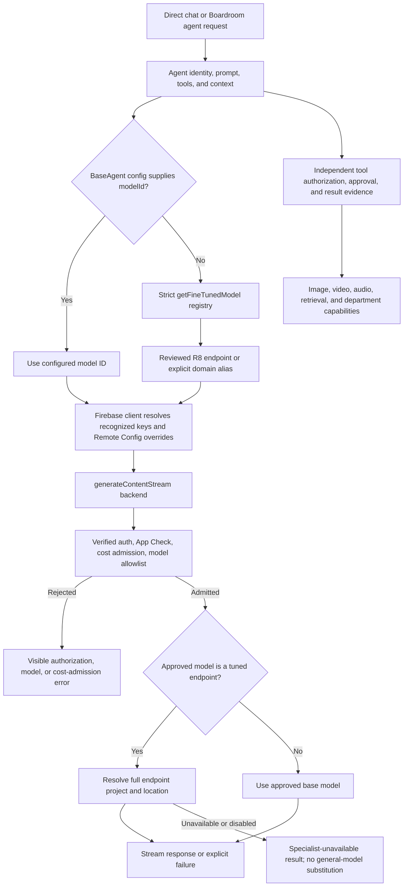
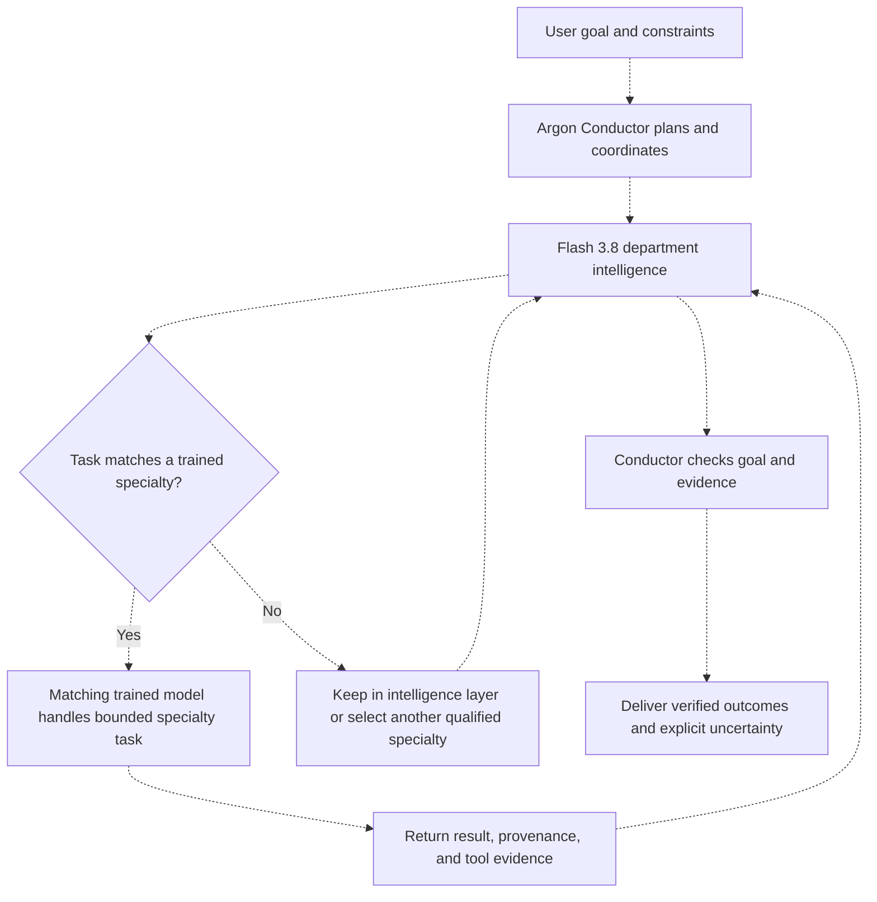

# Chat Model Routing and Intelligence Hierarchy

Reviewed against source on 2026-11-13. This chart distinguishes configured routing
from the founder's required hierarchy: Argon directs the Conductor, Flash 3.8
provides other agents' intelligence, and trained models perform matching specialty
tasks. Preserve the trained models, their identities, prompts, and tool boundaries.
Source inspection does not establish active Remote Config values, provider access,
or genuine deployed behavior.

## Inspected routing

The solid-edge diagram traces the primary BaseAgent streaming path.

## Configured model references

These are repository values, not a claim that a provider currently accepts every
ID or that each agent invokes it in production.

| Source and role | Configured reference | Routing implication |
| --- | --- | --- |
| Renderer `TEXT_AGENT` | `gemini-3.1-pro-preview` | Current client default for recognized agent capability keys; a Remote Config override can replace it. This literal is absent from the inspected server text-stream allowlist. |
| Renderer `TEXT_FAST` | `gemini-3.8-flash` | Configured workhorse reference, present in the server allowlist. |
| Server `TEXT.PRO` | `gemini-4-argon` | Server default when the stream request omits a model; present in the allowlist. It does not rewrite a supplied tuned endpoint. |
| Server `TEXT.FAST` | `gemini-3.8-flash` | Configured server workhorse reference. |
| Agent registry | Generated Vertex endpoint resource IDs and domain aliases | Default BaseAgent selection remains trained routing unless a model ID is supplied explicitly. Missing/disabled tuned routing fails visibly. |
| Fast and Pro images | `gemini-3.1-flash-image`, `gemini-3-pro-image` | Separate image paths; text routing changes do not prove image capability. |
| Server legacy image path | `gemini-2.5-flash-image` | Retained legacy image reference; validate its supported path separately. |

## Required intelligence hierarchy

Dashed edges describe the target and its acceptance work, not deployed-state proof.

## Transition Breakdown

1. [BaseAgent](../../packages/renderer/src/services/agent/BaseAgent.ts) gives an
   explicit `config.modelId` precedence; otherwise it calls the strict
   [trained-model registry](../../packages/renderer/src/services/agent/fine-tuned-models.ts).
   [IndiiNucleus](../../packages/renderer/src/services/agent/IndiiNucleus.ts) also
   explicitly selects the generalist tuned endpoint. Changing one model label
   cannot by itself establish the required hierarchy.
2. The [Firebase intelligence client](../../packages/renderer/src/services/intelligence/FirebaseIntelligenceService.ts)
   resolves recognized capability/model keys and optional Remote Config overrides.
   An unrecognized full endpoint ID is preserved. Active cloud overrides have not
   been inspected for this chart.
3. The [stream gateway](../../packages/firebase/src/index.ts) checks the
   [server-owned allowlist](../../packages/firebase/src/config/textStreamModels.ts),
   validates reservation coverage, and resolves approved tuned endpoint resources.
   A disabled or unavailable specialist produces a typed failure; it is not
   silently replaced with a general model. A public error alone does not identify
   the original provider/routing cause.
4. Compare [renderer model configuration](../../packages/renderer/src/core/config/intelligence-models.ts)
   with [server configuration](../../packages/firebase/src/config/models.ts).
   The client/server agent-default mismatch above needs resolution and exact-path
   verification; configured Argon availability does not prove Conductor dispatch.
5. Trained specialty dispatch, out-of-scope rerouting, and handoff remain separate
   acceptance requirements. Preserve the agents' specialized prompts and tools.
   Media models and capabilities retain their independent provider and admission
   paths, including fast, Pro, and legacy image references where supported.
6. Keep approvals request-bound and deterministic. See [approval lifecycle](08-bug-reporter-pipeline.md),
   [Boardroom execution](04-boardroom-context-orchestration.md), and
   [stream reservation lifecycle](agent-stream-reservation-boardroom-budget.md).
   Provider response, consent, tool execution, persisted receipt, and visible
   deliverable are distinct facts.

## Completion criteria

- Align actual Conductor and department dispatch with approved provider IDs and
  admission rules; retain trained models for matching specialty tasks.
- Verify specialty scope, out-of-scope rerouting, and result/evidence handoff.
- Exercise genuine authenticated direct chat and Boardroom paths, including
  request-bound approve/deny, interruption, and recovery.
- Verify fast and Pro image generation, retained supported legacy/media paths,
  and asset retrieval independently of text generation.
- Inspect exact-commit CI and genuine deployed results before declaring the
  migration complete. Source labels, an allowed ID, and local tests are partial
  evidence only.
