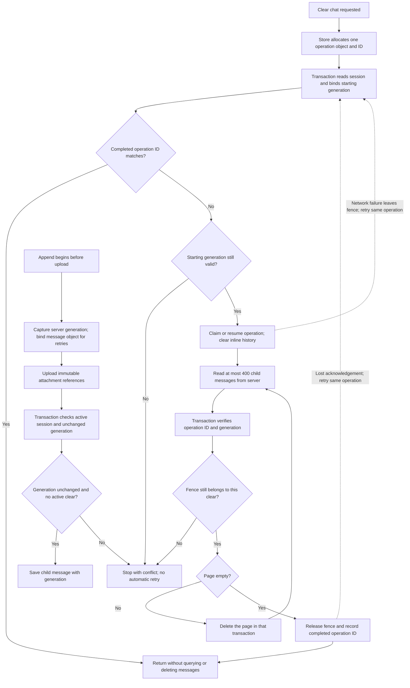

# Conversation clear generations

Purpose: explain how conversation clearing coordinates message writes and
persistence retries across devices. Implemented locally and verified by structural
service/store tests and isolated STANDARD Firestore emulator rules tests. Genuine
account and deployed acceptance remain open.

## Transition Breakdown

The parent session owns `messageEpoch`, `clearingOperation` and
`lastClearedOperation`. A distinct explicit clear may take over an interrupted
one by advancing the generation; every old worker verifies its ownership before
deleting. Automatic retries retain their original operation object and generation.
The completion receipt prevents a lost acknowledgement from clearing newly added
messages; generation binding rejects older retries after a newer clear.

Child writes use the post-write parent in security rules, so an atomic batch
cannot begin a clear and sneak an old-generation append through the same commit.
Generation zero supports legacy sessions. After a session has been cleared, old
clients that omit the generation fail closed and cannot restore inline history.
Client and rules changes require a coordinated release.

Source: `packages/renderer/src/services/agent/SessionService.ts`,
`packages/renderer/src/core/store/slices/agent/agentSessionSlice.ts`, and
`packages/firebase/firestore.rules`.

Remaining: uploaded objects can be orphaned when a clear invalidates an append;
this change does not delete attachment objects or prove cross-reload continuity of
an operation object. A fresh Clear chat request is an explicit new operation.
